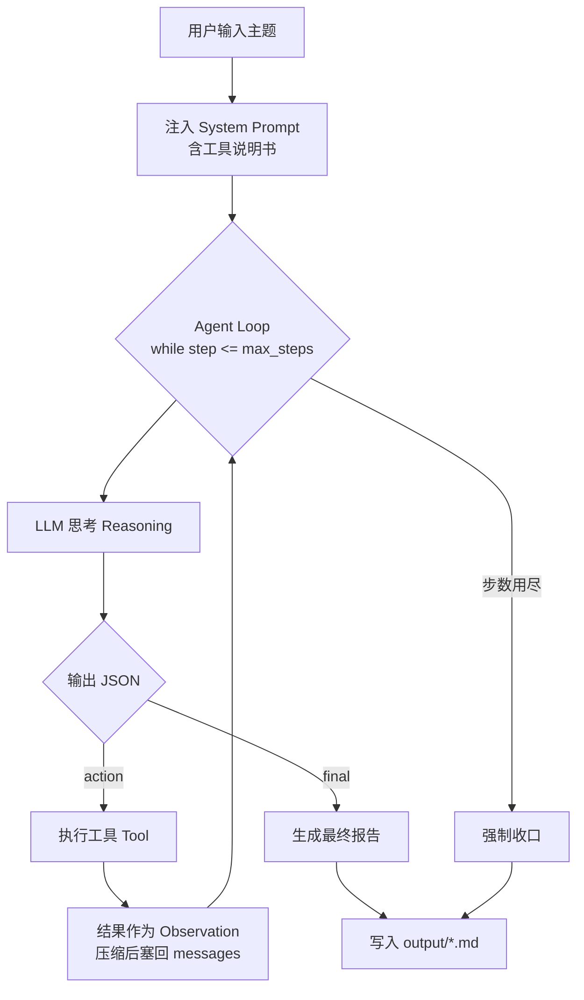

# AI 商业研究助手 v0.1

> 12 周计划的第一个产物。输入一个公司/主题，Agent 自主搜索 → 抓取 → 整理 → 输出中文商业分析报告。

## 它是什么（一句话）

不是"套壳聊天"，而是**一个有自主决策循环的程序**：模型决定搜什么、要不要深挖某个链接、什么时候收手写报告。

## 架构



## 关键认知（Week 1 的全部价值）

| 误解 | 事实 |
|---|---|
| "LLM 会联网" | LLM 只会输出 `{"tool":"web_search","input":{...}}`，联网的是 `tools.py` |
| "Agent 是个框架" | Agent = `while` 循环 + `messages` 列表 + 一个工具注册表 |
| "换个模型就变强" | 上限 ≈ 循环次数 × 工具质量 × 提示词约束力 |

## 项目结构

```
ai-research-agent/
├── main.py         # CLI 入口，生成报告落盘
├── agent.py        # Agent Loop 本体（核心，只有 ~150 行）
├── llm.py          # 极简 LLM 调用层：标准库 urllib，零依赖，自带重试与成本估算
├── tools.py        # 工具层：web_search / web_fetch / write_note
├── hello_llm.py    # Day1：裸调 LLM，证明 key 可用
├── docs/agent-flow.md
└── output/         # 报告 + 工具调用日志(_log-*.json)
```

**零第三方依赖**（不需要 `pip install openai`）。HTTP 走标准库 `urllib`，HTML 用正则清洗。
> 为什么不用官方 SDK：本机 `httpx 0.13.3` 过旧，在 Python 3.13 上 `import` 即崩（`cgi` 模块已被移除）。
> 而且 Week 1 的目标就是看清底层——LLM 调用本质只是一个 HTTP POST + JSON。

## 运行

```powershell
$env:DEEPSEEK_API_KEY="sk-xxxx"                       # 或永久写入用户环境变量

python hello_llm.py                                  # 先验证 key
python tools.py                                      # 再验证搜索能出结果
python main.py "分析字节跳动的AI战略"                  # 跑完整 Agent
python main.py "某主题" --steps 2                     # 故意限制步数做对照实验
```

## 真实缺陷（诚实写出来，这也是 W2 要修的）

1. **搜索可靠性是最大短板**（实测数据在下面）。爬 HTML 必然脆弱，**企业交付必须配搜索 API**。
2. **工具选择靠提示词，不稳**：偶尔输出非 JSON 格式 → 已做容错，但不如原生 function calling 稳。
3. **无记忆**：每次研究都从零开始，`write_note` 写了但不会被自动读回。
4. **无人工审核**：报告直接输出，没有"人确认后再发"的节点 —— 这正是 W2 LangGraph 要解决的（State / 条件边 / 中断审批）。
5. **成本不可控**：步数越多 token 烧得越快，没有预算上限。

## 搜索后端实测（2026-10-06，真实数据）

| 后端 | 连续搜索成功率 | 中文结果质量 | 结论 |
|---|---|---|---|
| DuckDuckGo (lite/html) | **0%**（限流）| — | 连续请求必被限流，实测 4 次挂 2 次 |
| 百度 | 0% | — | 直接返回"安全验证"反爬页（1418 字符），**已移除** |
| Bing | **100%** | **差** | 稳定但中文商业查询常返回百科/无关页 |
| Tavily / Serper / Bocha | 需 Key | 好 | **企业交付应走这里**（有免费额度） |

**Bing 质量差的具体证据**（同一台机器实测）：
```
查询"大模型 价格战 2025"      -> 首条 "大 （汉语文字）_百度百科"     ❌ 完全无关
查询"企业知识库 RAG 落地"      -> 首条 "GitHub - codex-auth-helper"  ❌ 完全无关
查询"字节跳动 AI 战略"         -> 首条 "字节 跳动 - ByteDance"        ⚠️ 官网首页
```
> 注：Bing 会在词间插入标签，导致标题出现 "字节 跳动" 这种空格，已用 `_strip_tags` 处理但无法完全消除。

**结论**：零成本能跑，但**不可交付**。W01 学概念够用；真接客户必须配一个搜索 API Key（Tavily 有免费额度，注册即可）。
配置方式：在 `12周计划\.env` 里加一行 `TAVILY_API_KEY=tvly-xxxx`，`web_search` 会自动优先使用它。

## 已知的"好行为"（值得保留）

实测中，当搜索质量差时模型**主动拒绝编造**：
> "资料不足以支撑完整报告，需明确标注未能获取的部分"

并且它**自主纠错**：发现搜索结果是官网首页 → 改用 `web_fetch` 直接抓取目标页面。
这正是 W01 要理解的 Agent 能力：**循环 + 工具 + 自我评估**。

## 下一步（W2）

用 LangGraph 重写为显式状态机：`生成研究计划 → 条件边决定是否补搜 → 报告生成 → 人工审核 → 输出`。

---
*Week 1 产出 · 2026-10*
