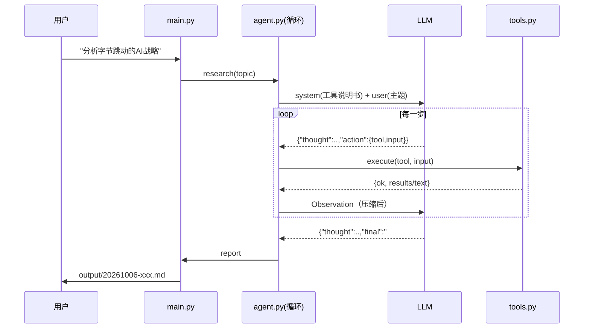

# Agent 流程图（W1 交付物）

## 1. 概念图：Agent Loop

```
        ┌──────────────────────────────────────────┐
        │                                          │
        ▼                                          │
   ┌─────────┐    ┌───────────┐    ┌────────┐    │
   │  Goal   │───▶│ Reasoning │───▶│ Action │    │
   │  目标   │    │ LLM 思考  │    │ 决定调用│    │
   └─────────┘    └───────────┘    └───┬────┘    │
                                      │         │
                          ┌───────────▼───────┐ │
                          │ Tool 执行（代码）  │ │
                          │ 搜索/抓取/写文件   │ │
                          └───────────┬───────┘ │
                                      │         │
                          ┌───────────▼───────┐ │
                          │ Observation       │─┘
                          │ 结果塞回上下文     │
                          └───────────┬───────┘
                                      │
                        模型判断：资料够了吗？
                                      │
                                 够了 ▼
                          ┌───────────────────┐
                          │   Final Report    │
                          └───────────────────┘
```

## 2. 本项目的实际时序



## 3. 关键设计决策与理由

| 决策 | 理由 | 代价 |
|---|---|---|
| 用 JSON 文本协议而非原生 function calling | 任意 OpenAI 兼容端点都能跑，换模型零改造成本 | 格式稳定性差，必须容错 |
| Observation 超 6000 字符截断 | 上下文是成本与延迟第一杀手 | 可能丢掉关键细节 |
| 保留 `max_steps` 强制收口分支 | 真实 Agent 必须能"带着不完美的资料交付" | 报告质量下降 |
| 每次运行都写 `_log-*.json` | 可回放、可归因：是模型笨还是工具烂 | 占磁盘 |

## 4. 我自己的一句话总结（W1 结束前手写，不许抄）

>
