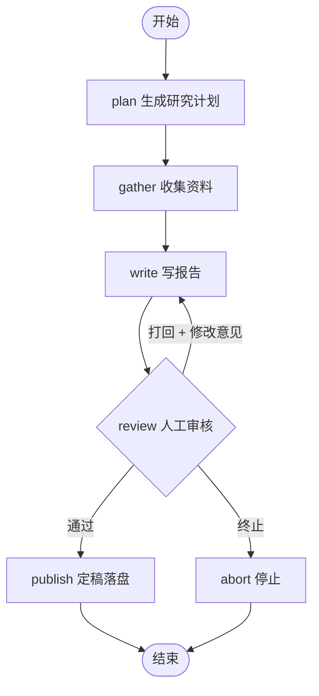

# langgraph-mini —— 150 行看懂 LangGraph

Week 2 的学习产物。**不用装 langgraph 也能跑**，因为它就是 LangGraph 的核心思想。

## 三个词，三行代码

| 概念 | 在本项目里的位置 | 一句话 |
|---|---|---|
| **State** | `workflow.py` 里那个 dict | 在节点间流转的共享状态 |
| **Node** | `add_node("write", node_write)` | 一个纯函数：`state -> 要更新的字段` |
| **Edge** | `add_edge` / `add_conditional_edge` | 固定跳转 / 按 state 决定跳哪 |

## 架构（这就是 W02 的交付物）



## 运行

```powershell
python workflow.py --draw                       # 只打印状态图
python workflow.py "某主题" --mock              # 不花钱，验证图能跑通（强烈建议先跑这个）
python workflow.py "分析字节跳动的AI战略" --auto  # 真跑，自动过审
python workflow.py "分析字节跳动的AI战略"         # 真跑，中途停下来问你审不通过
```

## 亲手做的对照实验（Day 3 任务）

审核时按 `n` 打回，写一句修改意见（例如"第 3 节太空，要有具体数字"），
观察它是不是**真的按你的意见改了**。

> 这个体验就是你以后卖给客户的核心卖点：
> **"AI 不是自己乱发东西，它写完必须过你这一关。"**

## 与真 LangGraph 的差异（诚实清单）

| 能力 | 本迷你版 | 真 LangGraph |
|---|---|---|
| State / Node / Edge / 条件边 | ✅ 完全一致 | ✅ |
| 中断与恢复（checkpointer） | ⚠️ 靠函数内 `input()` 模拟 | ✅ 原生支持，可存数据库 |
| 并行分支 / 子图 | ❌ | ✅ |
| 可视化 | 手写 mermaid | 官方 studio |
| 持久化 | ❌ | ✅ |

**结论：概念已经完全掌握，剩下的是 API 熟练度问题。** 别在装环境上浪费两天。
